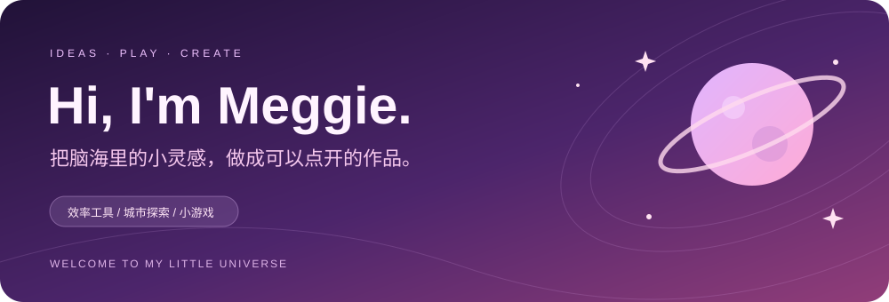
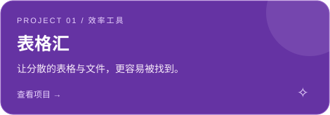
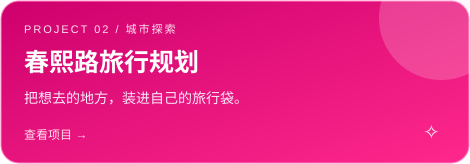
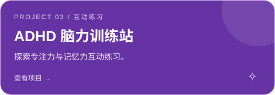
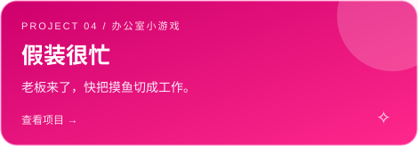
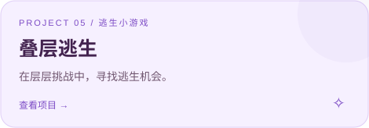
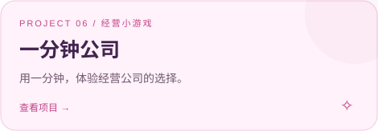

  

  <strong>一点好奇心，一点想象力，和正在发生的创造。</strong> 
  探索效率工具、城市旅行和轻量小游戏，记录每一个想法变成作品的过程。

💜 灵感收集 &nbsp; · &nbsp; 🌷 动手创造 &nbsp; · &nbsp; ✨ 持续打磨

### 🌸 我的作品花园

这些项目仍在探索和迭代中。点击卡片可以查看代码与项目说明。

  
  

  
  

  
  

### 🪻 最近在探索

- **把工具做得更顺手**：整理表格、寻找文件，减少重复操作。
- **把出行变得更轻松**：从想去的地点出发，规划城市探索。
- **把小点子变成小游戏**：尝试不同节奏、选择和反馈。

✧ ─────────── ⋆ 🌙 ⋆ ─────────── ✧ 慢慢来，也在向前。Made with curiosity & a little pink.

